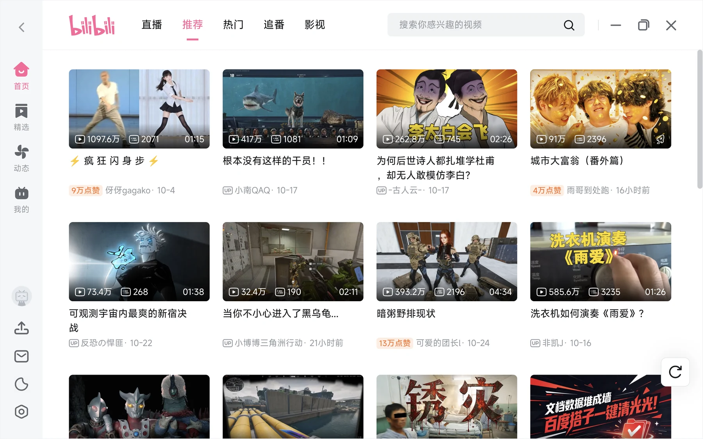
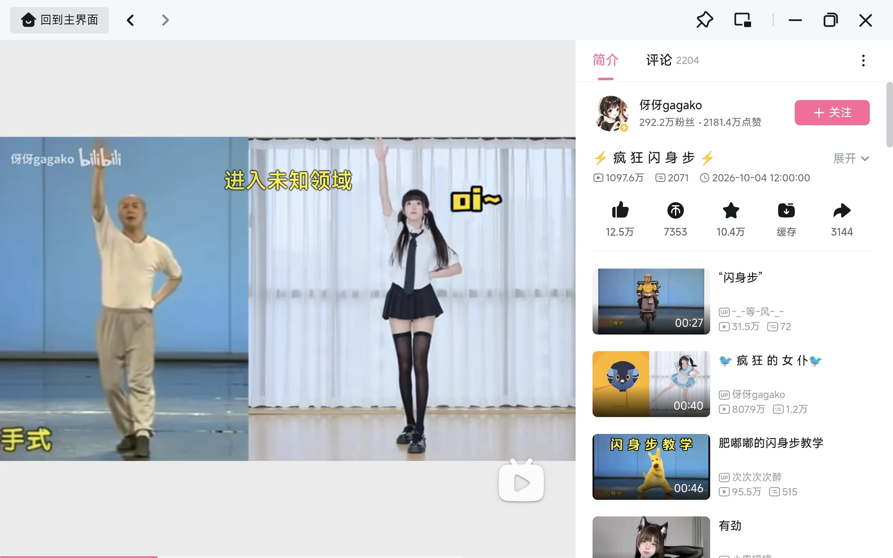
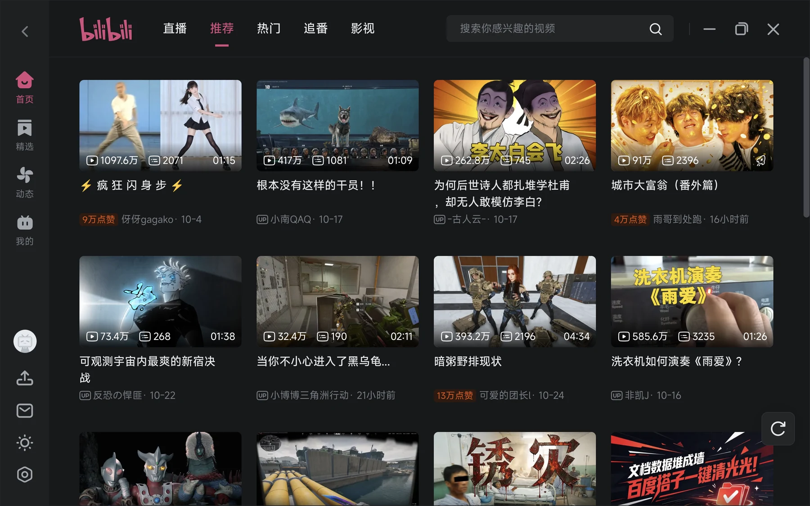
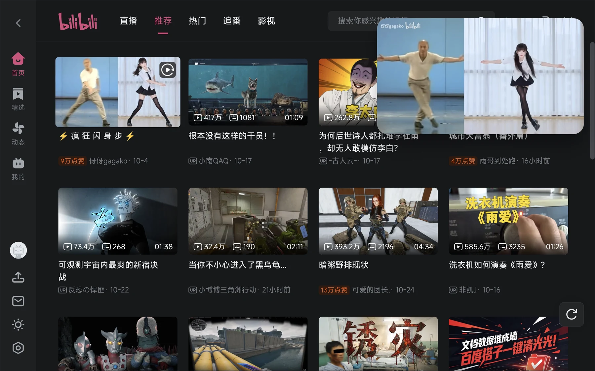

<p align="center">
  <b>简体中文（Android 版）</b> ·
  <a href="README_linux.MD">Linux 桌面版</a> ·
  <a href="README_en.MD">English</a>（Linux） ·
  <a href="README_zh-tw.MD">繁體中文</a>（Linux）
</p>

# Bili Tablet

**把哔哩哔哩 PC 客户端搬到 Android 平板。**

不是网页版套壳，也不是把手机 App 等比放大——这个项目直接复用官方桌面客户端的
`render` 界面，在 Android WebView 里还原 PC 端的顶栏、左侧导航、四列卡片、
播放器和窗口交互。

[下载 APK](https://github.com/xlzhen-940218/bilibili-linux-android/releases) ·
[截图](#截图) · [实现原理](#实现原理) · [构建](#构建)

## 截图

<p align="center">
  
  
</p>
<p align="center">
  
  
</p>

## 为什么做这个

Android 平板上的哔哩哔哩 HD 版，本质是手机 UI 放大：

- 顶部大搜索栏 + 巨型轮播，首屏只有 1 个推荐和 4 个矮卡片；
- 底部手机 tab 栏占掉一块屏幕；
- 没有左侧导航、没有多列信息密度、没有 hover / 右键 / 分屏。

PC 客户端是另一套信息架构：左侧竖排导航、顶部频道栏、四列卡片网格、
视频页左视频右推荐。这个项目把 PC 客户端的 `render` 页面直接搬进 Android，
让 11 寸平板得到接近桌面的浏览体验。

## 特性

### 桌面级界面

- 官方 render 页面：单行顶栏、直播 / 推荐 / 热门 / 追番 / 影视、
  左侧导航（首页 / 精选 / 动态 / 我的）、四列视频卡片；
- 播放页：左侧视频 + 右侧简介 / 评论 / UP 主 / 推荐；
- 个人空间：动态流、投稿视频、合集和系列；
- 深色模式：浅色 / 深色 / 跟随系统，切换立即生效，重启后保持。

### 完整功能

- **登录**：官方 passport 登录页，二维码 / 账号密码 / 短信，Cookie 与主界面共享；
- **播放器**：官方 nano 播放核心，视频、弹幕、字幕、倍速、选集、全屏；
- **独立播放页**：首页和播放页是独立任务，播放页可单独分屏；关闭播放页回首页不刷新；
- **窗口按钮**：首页最小化回桌面 / 全屏无响应 / 关闭退出；
  播放页最小化回桌面 / 全屏切换进 PiP / 关闭回首页；
- **画中画**：播放页或迷你播放器进入 Android 系统 PiP，小窗继续播放；
- **媒体通知**：封面、标题、UP 主/简介、进度条、播放/暂停，MediaSession 同步状态；
- **设置**：启动项、下载、缓存、播放、消息等开关持久化；
- **其他**：下载、返回键、非 http(s) 协议、自适应图标。

### 大屏与平板

- 横屏为主，竖屏可用（竖屏是紧凑布局，推荐横屏）；
- 11 寸及以上平板体验最佳；
- 手机窄屏会自动退回移动布局，避免桌面布局被压到不可读。

## 下载

**https://github.com/xlzhen-940218/bilibili-linux-android/releases**

- Android 8.0+（minSdk 26）；
- 首次启动请允许通知权限（Android 13+），用于播放页媒体通知；
- 侧载安装，不需要 root。

## 实现原理

项目没有重写客户端，而是复用官方桌面客户端的 Web 前端：

1. 从本机官方 Windows 客户端
   `C:\Program Files\bilibili\resources\app.asar` 提取 `render/`（Vue 应用，28 MB）；
2. WebView 加载 `https://bilipc.bilibili.com/index.html`，
   `shouldInterceptRequest` 把该域映射到 `assets/render/`；
3. 注入 `bridge.js`，复刻 Electron preload 的 `window.biliBridgePc`，
   补齐 `app/getInitInfo`、`system/getPlayerInfo`、`auth/getUserInfo` 等启动接口；
4. 原生代理 `api.bilibili.com` / `app.bilibili.com` / `api.vc.bilibili.com` 的 GET 请求，
   带 Cookie / Referer，回显 `Origin` 并补 CORS 头
   （WebView 跨域，不能像 Electron 主进程那样直接放行）；
5. Android 侧接管登录 Activity、播放器通知、系统 PiP、主题和设置持久化。

### 目录

```
android/
├── app/src/main/
│   ├── assets/
│   │   ├── bridge.js              # biliBridgePc polyfill
│   │   └── render/                # 官方客户端 render 资源
│   ├── java/com/xlzhen/bilitablet/
│   │   ├── BiliWebActivity.kt     # WebView 基类：请求拦截、代理、PiP、主题、JS 桥
│   │   ├── MainActivity.kt        # 首页：独立任务，关闭退出软件
│   │   ├── PlayerActivity.kt      # 播放页：独立任务、可分屏、全屏切换进 PiP
│   │   ├── LoginActivity.kt       # 官方 passport 登录
│   │   ├── PlaybackNotification.kt
│   │   ├── PlaybackController.kt
│   │   ├── PlaybackActionReceiver.kt
│   │   ├── ThemePrefs.kt
│   │   └── SettingsStore.kt
│   └── res/                       # 自适应图标、多尺寸 WebP
└── gradle/                        # Gradle 9.6.0 wrapper
```

## 构建

要求：JDK 17、Android SDK Platform 35。

```bash
cd android
export JAVA_HOME=/path/to/jdk17
./gradlew assembleDebug
adb install -r app/build/outputs/apk/debug/app-debug.apk
```

> 工程当前使用 AGP 9.4.0 / Kotlin 2.2.10 / Gradle 9.6.0。

## 已验证

在 Pixel 6（Android 17）和 11 寸 Android 平板上验证：

- 首页渲染出客户端原生顶栏、左侧竖排导航、四列卡片和真实推荐数据；
- 首页点击视频只打开一个播放页，不会重复创建窗口或自动进入画中画；
- 真实账号登录后，头像、昵称、等级、大会员、动态/关注/粉丝、历史记录正常；
- 个人空间「动态」和「投稿」都能加载真实内容；
- 播放页视频、字幕、评论、推荐正常，可回到主界面；
- 播放页按 Home 或迷你播放器按钮进入系统 PiP，关闭按钮可退出并回首页；
- 媒体通知包含封面、标题、UP 主/简介、进度和播放/暂停，状态与视频同步；
- 深色模式切换立即生效，重启后保持；设置页开关重启后保持。

## 已知限制

- POST 请求（点赞、评论等）未代理：`shouldInterceptRequest` 拿不到 POST body；
  登录页在 `passport.bilibili.com` 同域内完成，不经过该代理，因此登录本身不受影响；
- 空间页动态/投稿、评论详情依赖对官方 render JS 的本地补丁：
  `Space.75f46eb4.js`、`AllFeedFragment.025ca0f7.js`、`index.55978b26.js`
  （APP_VERSION 兜底、评论详情改用 `reload` 重置状态）；客户端资源更新后需要重新打；
- 系统 PiP 小窗里页面按钮不可点击（Android 限制），只能使用系统提供的关闭/全屏；
- 开机自启、下载目录选择、托盘行为等桌面能力在 Android 上尚未实现；
- 竖屏时顶栏频道与搜索框会显得拥挤，推荐横屏使用。

## 声明

- 非官方项目，与哔哩哔哩无任何关联；
- `render/` 资源版权归哔哩哔哩，仅供个人学习与自用；
- 请勿用于商业分发或上架应用商店。

## 致谢

- [bilibili-linux](https://github.com/msojocs/bilibili-linux)：本项目的思路来源；
- 哔哩哔哩官方桌面客户端：render 界面与播放器核心。
